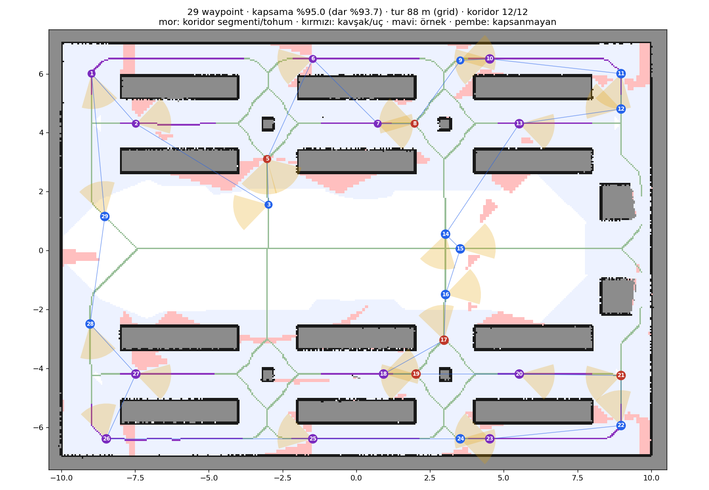
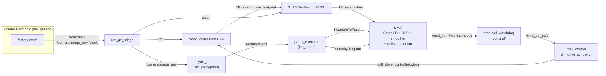
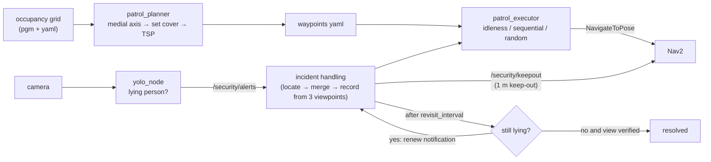
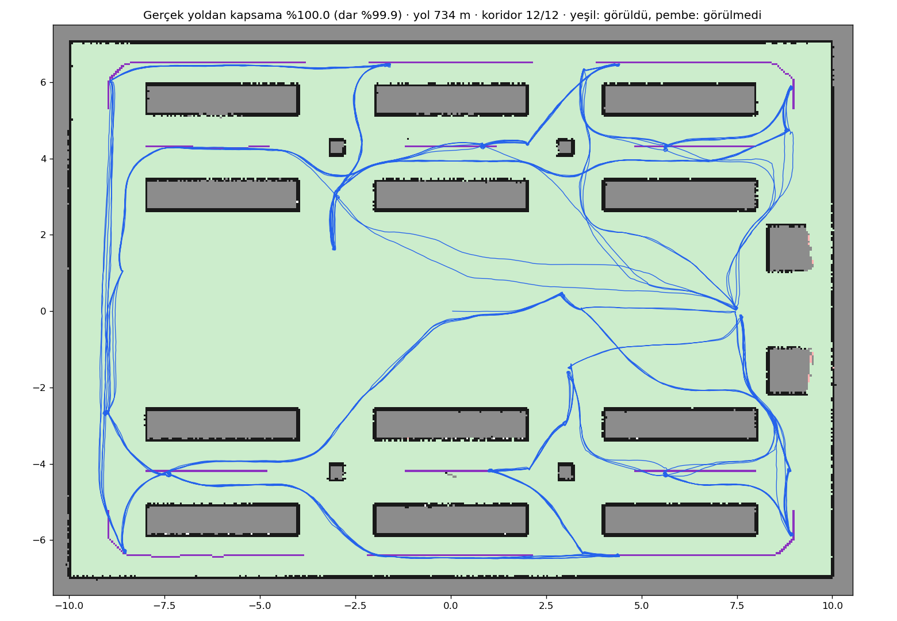

# Factory Security Robot (`factory_security_bot_ws`)

**English** | [Türkçe](README.md)

[](https://github.com/KayraDev0/factory_security_bot_ws/actions/workflows/ci.yml)


[](LICENSE)

Simulation of an **autonomous factory security patrol robot** on ROS 2 Jazzy and Gazebo Harmonic.
The robot generates its own patrol route from a saved occupancy grid (medial axis, set cover, TSP),
drives it with Nav2, and uses YOLOv8-pose on its camera image to detect a **person lying on the
floor**. A detected person is added to an incident list; the robot records the scene from several
viewpoints, places a temporary keep-out zone around the person and re-checks the position at
intervals.

<p align="center">
  
  <br><em>Patrol waypoints generated automatically from the map (29 waypoints, 95.02 % planned coverage).</em>
</p>

> **Status:** All results come from simulation. No physical robot has been built yet; the hardware
> interface (`fsb_hardware`) is planned and not part of this repository. See
> [docs/HARDWARE.md](docs/HARDWARE.md).

## Contents
- [Architecture](#architecture) · [Requirements](#requirements) · [Installation](#installation) · [Usage](#usage)
- [Configuration](#configuration) · [Testing](#testing) · [Project structure](#project-structure) · [Documentation](#documentation)
- [Attributions](#attributions) · [License](#license)

## Architecture

Simulation and the (planned) real robot run **the same control stack**; the only difference is the
ros2_control hardware plugin selected by the `use_sim` xacro argument. `use_sim_time` is set once in
`bringup.launch.py` and passed down.



Without the watchdog, Nav2's `/cmd_vel` goes directly to the controller.

| Component | Role |
|---|---|
| **Gazebo + `ros_gz_bridge`** | Factory world (20 × 14 m); bridges LiDAR (`/scan`), camera (`/camera/image_raw`, `/camera/camera_info`), IMU (`/imu`) and `/clock` |
| **ros2_control** | `joint_state_broadcaster` + `diff_drive_controller`; `gz_ros2_control` plugin in simulation |
| **robot_localization (EKF)** | Fuses wheel odometry and IMU yaw rate; sole owner of the `odom→base_footprint` TF |
| **SLAM Toolbox / AMCL** | `localization:=slam` for mapping, `localization:=amcl` for localisation; sole owner of `map→odom` (never launched together) |
| **Nav2** | Smac 2D global planner, Regulated Pure Pursuit controller, velocity smoother, collision monitor; obstacle sources `/scan` and `/security/keepout` |
| **`patrol_planner`** | Generates waypoints from the map (flow below); also runs without Nav2 (`--cost grid`) |
| **`patrol_executor`** | Sends waypoints (`idleness`, `sequential`, `random`) as `NavigateToPose` goals; handles lying-person incidents |
| **`coverage_monitor`** | Measures how much of the free space the robot's camera actually saw along its path |
| **`yolo_node`** | YOLOv8n-pose person detection, rule-based posture classification (`lying` / `upright` / `unknown`), alerts with temporal confirmation |
| **`cmd_vel_watchdog`** | Publishes zero velocity if commands stop for 0.5 s |

For TF ownership and drift prevention see [docs/ARCHITECTURE.md](docs/ARCHITECTURE.md).

### Patrol and incident flow



Incidents are stored under `~/.ros/fsb_security` (`watchlist.yaml`, `events.jsonl`, frames) and
reloaded on restart. Details: [docs/PATROL_PLANNER.md](docs/PATROL_PLANNER.md),
[docs/PERCEPTION.md](docs/PERCEPTION.md).

<p align="center">
  
  <br><em>Coverage measured along the real patrol path (<code>coverage_monitor</code> output).</em>
</p>

## Requirements

| Requirement | Version / note |
|---|---|
| OS | Ubuntu 24.04 (Noble); WSL2 also works |
| ROS 2 | Jazzy (`/opt/ros/jazzy`), installed from [deb packages](https://docs.ros.org/en/jazzy/Installation/Ubuntu-Install-Debs.html). The install script does not install ROS 2 itself |
| Gazebo | Harmonic (gz-sim 8); pulled in through `rosdep` (`ros_gz_*`, `gz_ros2_control`) |
| Python | 3.12 (Ubuntu 24.04 system Python) |
| GPU (optional) | With a CUDA-capable NVIDIA GPU, YOLO uses `cuda:0`; otherwise CPU (`yolo_device:=cpu`). Inference runs at ~5 Hz |
| Network | The human models are downloaded from Fuel on the first Gazebo start (~29 MB) |

## Installation

```bash
# 1. Clone
git clone https://github.com/KayraDev0/factory_security_bot_ws.git
cd factory_security_bot_ws

# 2. System dependencies (apt tools + all package.xml dependencies via rosdep; asks for sudo)
scripts/install_deps.sh             # check only: scripts/install_deps.sh --check

# 3. Build (--symlink-install is not used)
source /opt/ros/jazzy/setup.bash
colcon build
source install/setup.bash
```

`install_deps.sh` runs `rosdep install --from-paths src --ignore-src --rosdistro jazzy -y`; you can
also run that command directly.

### Python environment for perception (optional)
`ultralytics` and `torch` are installed into a **separate venv** without `opencv-python` (which
would shadow the system OpenCV and break `cv_bridge`), and the YOLOv8n-pose weights are downloaded:

```bash
scripts/setup_perception_venv.sh                  # ~/fsb_venv and ~/yolov8n-pose.pt
# CPU only:
TORCH_INDEX=https://download.pytorch.org/whl/cpu scripts/setup_perception_venv.sh
```

Locations can be changed with the `VENV` and `MODEL_DIR` environment variables. If you skip this
step, run without perception (`perception:=false`, the default).

## Usage

In every terminal (the **same** `ROS_DOMAIN_ID` everywhere):

```bash
cd ~/factory_security_bot_ws
source /opt/ros/jazzy/setup.bash && source install/setup.bash
export ROS_DOMAIN_ID=85
```

The single entry point is `fsb_bringup/launch/bringup.launch.py`. Main arguments:

| Argument | Default | Description |
|---|---|---|
| `use_sim` | `true` | `true`: Gazebo; `false`: real robot (not available yet) |
| `world` | `factory.sdf` | Gazebo world (`factory_person.sdf`, `factory_lying.sdf`, `factory_negative.sdf`) |
| `headless` | `false` | `true`: server only (`gz sim -s`), no GUI |
| `localization` | `none` | `none` \| `slam` (mapping) \| `amcl` (AMCL + Nav2) |
| `map` | `fsb_navigation/maps/factory.yaml` | Map for `amcl` |
| `rviz` | `false` | Start RViz (`none` → `sim.rviz`, otherwise `nav.rviz`) |
| `patrol` | `false` | Start the patrol (requires `localization:=amcl`) |
| `patrol_mode` | `idleness` | `idleness` \| `sequential` \| `random` \| `legacy` |
| `loops` | `0` | Number of loops, `0` = endless |
| `coverage` | `false` | Start `coverage_monitor` |
| `perception` | `false` | Start YOLOv8 perception (needs `~/fsb_venv`) |
| `yolo_device` | auto | `cpu` \| `cuda:0` |
| `image_transport` | `raw` | `compressed`: JPEG stream (if YOLO runs on another machine) |
| `cmd_vel_watchdog` | `false` | Insert the command watchdog |
| `revisit_interval` | `300.0` | Time before a lying person is re-checked (sim-s) |
| `security_log_dir` | `~/.ros/fsb_security` | Incident list, `events.jsonl`, frames |

### 1. Start the simulation
```bash
ros2 launch fsb_bringup bringup.launch.py                   # with Gazebo GUI
ros2 launch fsb_bringup bringup.launch.py headless:=true    # server only
```
Start order: `robot_state_publisher` → Gazebo + bridge + spawn → `joint_state_broadcaster` →
`diff_drive_controller` → EKF.

### 2. Build a map with SLAM and save it
```bash
# Terminal 1: mapping (map→odom: SLAM Toolbox)
ros2 launch fsb_bringup bringup.launch.py headless:=true localization:=slam rviz:=true

# Terminal 2: scripted tour (or drive by teleop)
ros2 run fsb_gazebo mapping_tour.py

# Terminal 3: save the map
mkdir -p ~/maps
ros2 run nav2_map_server map_saver_cli -f ~/maps/factory_new \
    --ros-args -p use_sim_time:=true

# Measure map quality (optional)
ros2 run fsb_gazebo map_quality_check.py --map ~/maps/factory_new.yaml
```
Angular speed is kept low while mapping (scripted tour: 0.15 m/s, ≤ 0.4 rad/s) to avoid SLAM drift.

### 3. Navigate with a saved map
```bash
ros2 launch fsb_bringup bringup.launch.py localization:=amcl rviz:=true \
    map:=$HOME/maps/factory_new.yaml
```
Without `map`, the bundled map (`fsb_navigation/maps/factory.yaml`) is used. In RViz, use the
*2D Pose Estimate* and *Nav2 Goal* tools to give goals.

### 4. Plan and start a patrol
Waypoints are generated from the map; no world coordinates are hard-coded:
```bash
ros2 run fsb_patrol patrol_planner --cost grid \
    --map src/fsb_navigation/maps/factory.yaml \
    --robot-params src/fsb_patrol/config/robot_params.yaml \
    --out /tmp/wp.yaml --png /tmp/wp.png
# exit code 2 if the target coverage is not reached
```
For `--cost nav2`, start the backend that uses Nav2 costs with
`ros2 launch fsb_patrol planner_backend.launch.py map:=<yaml>`. The bundled
`config/waypoints_factory.yaml` belongs to the bundled factory map; regenerate it for a new map.

Start the patrol with a single command (Gazebo + RViz + AMCL/Nav2 + `patrol_executor`):
```bash
ros2 launch fsb_bringup bringup.launch.py localization:=amcl rviz:=true patrol:=true loops:=5
# patrol_mode:=sequential | random | legacy, coverage:=true
```
Or, once Nav2 is up, in a separate terminal with your own waypoint file:
```bash
ros2 launch fsb_patrol patrol_executor.launch.py use_sim_time:=true mode:=idleness loops:=5 \
    waypoints_file:=/tmp/wp.yaml
```

### 5. Watch perception and alerts
With perception in the world that contains a lying person:
```bash
ros2 launch fsb_bringup bringup.launch.py localization:=amcl rviz:=true patrol:=true \
    perception:=true \
    world:=$(ros2 pkg prefix fsb_gazebo)/share/fsb_gazebo/worlds/factory_lying.sdf
# YOLO on another machine / low bandwidth: image_transport:=compressed cmd_vel_watchdog:=true
```
In another terminal:
```bash
ros2 topic hz   /perception/detections      # ~5 Hz
ros2 topic echo /perception/posture --once  # lying | upright | unknown
ros2 topic echo /security/alerts            # lying-person alert (vision_msgs/Detection2D)
ros2 run rqt_image_view rqt_image_view      # /perception/image_annotated
ros2 run fsb_gazebo posture_monitor.py      # per-posture counts + alert summary (Ctrl+C)
```
| Topic | Type | Content |
|---|---|---|
| `/perception/detections` | `vision_msgs/Detection2DArray` | Person detections |
| `/perception/posture` | `std_msgs/String` | Posture class |
| `/perception/image_annotated` | `sensor_msgs/Image` | Annotated frame (a `/compressed` variant exists) |
| `/security/alerts` | `vision_msgs/Detection2D` | Lying-person alert with temporal confirmation |
| `/security/keepout` | `sensor_msgs/PointCloud2` | Keep-out zone fed to the Nav2 obstacle layer |
| `/patrol/waypoints` | `visualization_msgs/MarkerArray` | State-coloured waypoints and incident markers |

In RViz (`nav.rviz`): orange = current target, green = visited, red = skipped, blue = pending,
purple = priority point; red sphere = lying person on the incident list.

### 6. RViz
Started with `rviz:=true`: `sim.rviz` when `localization:=none` (fixed frame `odom`; scan, camera,
EKF), `nav.rviz` for `slam`/`amcl` (fixed frame `map`; map, AMCL particles, plans, costmaps,
waypoints, YOLO image). For the robot model only:
`ros2 launch fsb_description display.launch.py`.

## Configuration

| File | Purpose |
|---|---|
| `fsb_description/urdf/fsb_properties.xacro` | **Single source of physical parameters** (wheels, chassis, sensor poses, masses) |
| `fsb_control/config/controllers.yaml` | `joint_state_broadcaster`, `diff_drive_controller` (speed/acceleration limits, `enable_odom_tf: false`) |
| `fsb_control/config/ekf.yaml` | `robot_localization` EKF fusion (wheel odometry + IMU yaw rate) |
| `fsb_gazebo/config/gz_bridge.yaml` | Gazebo → ROS bridge topics (`/clock`, `/scan`, `/camera/*`, `/imu`) |
| `fsb_navigation/config/nav2_params.yaml` | AMCL, map_server, bt_navigator, RPP, Smac 2D, costmaps, velocity smoother, collision monitor |
| `fsb_navigation/config/slam_toolbox_mapping.yaml` | Online async mapping parameters |
| `fsb_patrol/config/robot_params.yaml` | Planner input: robot radius, safety margin, camera FoV/range, costmap inflation |
| `fsb_patrol/config/waypoints_factory.yaml` | Generated waypoints and path-length matrix for the factory map |
| `fsb_patrol/config/priority_points_factory.yaml` | Hand-placed priority points to visit more often (`weight`) |
| `fsb_patrol/config/patrol.yaml` | Waypoints of the legacy 4-point `patrol_node` |
| `fsb_perception/config/yolo.yaml` | Model path, confidence threshold, inference rate, posture and alert thresholds |

Speed limits (RPP, smoother, controller) must stay consistent with each other; a test guards this.
`use_sim_time` is only given as a launch argument, never in yaml files.

## Testing

```bash
colcon test
colcon test-result --all --verbose
# or the same steps as CI:
scripts/ci.sh
```
Level 1 (lint + unit tests) and Level 2 (planner, 7 map variants) need no simulator or GPU and run
in CI. Level 3 (perception) and Level 4 (simulation integration) are run manually; commands and
measured results are in [docs/TESTING.md](docs/TESTING.md).

## Project structure

```
factory_security_bot_ws/
├── src/
│   ├── fsb_bringup/       # Single entry point (bringup.launch.py), RViz configurations
│   ├── fsb_control/       # ros2_control, EKF configuration, cmd_vel_watchdog
│   ├── fsb_description/   # URDF/xacro robot model, physical parameters, consistency test
│   ├── fsb_gazebo/        # Factory worlds, gz bridge, sim launch, measurement scripts
│   ├── fsb_navigation/    # SLAM Toolbox, AMCL, Nav2 configuration, saved map
│   ├── fsb_patrol/        # patrol_planner, patrol_executor, incident handling, coverage_monitor
│   └── fsb_perception/    # yolo_node (YOLOv8-pose), posture rules, image compression
├── docs/                  # Architecture, hardware, perception, patrol, testing docs and images
├── media/                 # README images
├── scripts/               # install_deps.sh, setup_perception_venv.sh, ci.sh
└── .github/workflows/     # CI (build + test in the ros:jazzy container)
```

## Documentation

| Document | Content |
|---|---|
| [docs/ARCHITECTURE.md](docs/ARCHITECTURE.md) | Design goal, packages, TF ownership, odometry, command path |
| [docs/PATROL_PLANNER.md](docs/PATROL_PLANNER.md) | Waypoint planning, patrol modes, incident handling, results |
| [docs/PERCEPTION.md](docs/PERCEPTION.md) | YOLOv8-pose node, posture rules, measurements, limitations |
| [docs/HARDWARE.md](docs/HARDWARE.md) | Planned hardware, motor selection calculations, unverified items |
| [docs/firmware.md](docs/firmware.md) | Arduino Nano firmware build/flash notes |
| [docs/TESTING.md](docs/TESTING.md) | Four-level test plan and simulation measurements |

## Attributions

The components below are **not copied** into this repository; they are installed via apt, pip or
Gazebo Fuel, or used from a separate repository. Licences were read from each component's own
sources (package `package.xml` files, GitHub repositories, PyPI, the Fuel API) on 2026-11-20.

| Component | Use | Licence |
|---|---|---|
| [Andino](https://github.com/Ekumen-OS/andino) (Ekumen) | Reference hardware platform: dimensions and firmware as an external dependency | BSD-3-Clause, Copyright (c) 2023 Ekumen Inc. |
| [Ultralytics YOLOv8](https://github.com/ultralytics/ultralytics) | Runtime dependency of `fsb_perception`, in a **separate venv**; the `yolov8n-pose.pt` weights are downloaded by the setup script | AGPL-3.0 (alternative: Ultralytics Enterprise licence) |
| [ROS 2 Jazzy](https://docs.ros.org/en/jazzy/) (rclpy, tf2, launch…) | Framework | Mostly Apache-2.0 |
| [Nav2](https://github.com/ros-navigation/navigation2) | Navigation stack | Apache-2.0; `nav2_amcl` LGPL-2.1-or-later |
| [SLAM Toolbox](https://github.com/SteveMacenski/slam_toolbox) | Mapping | LGPL |
| [ros2_control](https://github.com/ros-controls/ros2_control) / [ros2_controllers](https://github.com/ros-controls/ros2_controllers) | Controller management, `diff_drive_controller` | Apache-2.0 |
| [robot_localization](https://github.com/cra-ros-pkg/robot_localization) | EKF | Apache-2.0 |
| [Gazebo Sim (Harmonic)](https://github.com/gazebosim/gz-sim), [ros_gz](https://github.com/gazebosim/ros_gz), [gz_ros2_control](https://github.com/ros-controls/gz_ros2_control) | Simulation and ROS integration | Apache-2.0 |

**Gazebo Fuel human models** (OpenRobotics; not stored in the repository, downloaded to
`~/.gz/fuel` on first start):

| Model | Used in | Licence |
|---|---|---|
| Walking person | `factory_person.sdf`, `factory_negative.sdf` | CC0 1.0 |
| Casual female | `factory_lying.sdf` | CC0 1.0 |
| Standing person | worlds generated with `generate_factory_world.py` | CC0 1.0 |
| Rescue Randy | worlds generated with `generate_factory_world.py` | CC BY 4.0 (attribution: OpenRobotics) |

**Ultralytics note:** `fsb_perception` contains no Ultralytics code and only imports it at runtime;
Ultralytics is not distributed in this repository. If you plan to distribute a system with this node
or offer it as a network service, review the current licence terms (AGPL-3.0 or a commercial
licence) yourself. This note is not legal advice.

**Andino note:** the robot's dimensions were re-entered by hand from Andino; no Andino file is
copied. The firmware and 3D-print (STL) files are not in this repository; download them from the
Andino repository. If a firmware binary is distributed, Andino's licence notice must accompany it.

## License

Source code in this repository is licensed under the [Apache License 2.0](LICENSE) —
Copyright 2026 KayraDev0. The third-party components listed above are subject to their own licences.
