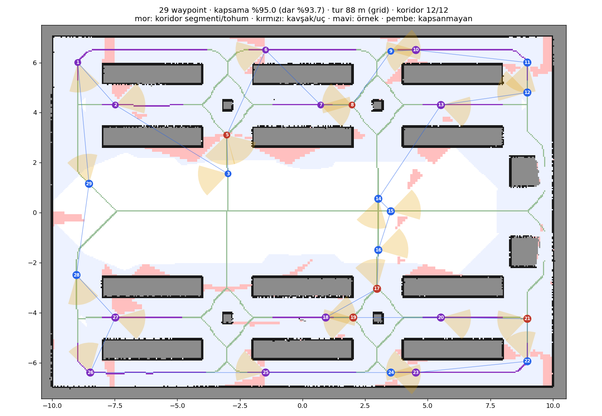
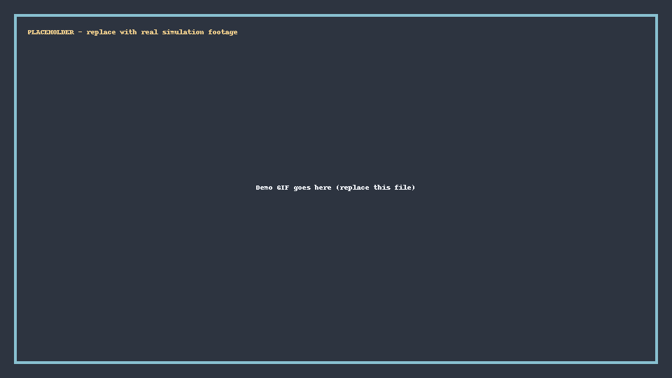
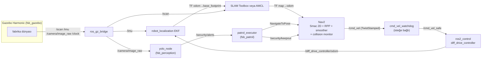
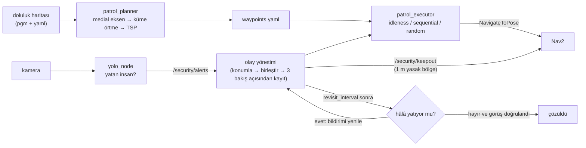
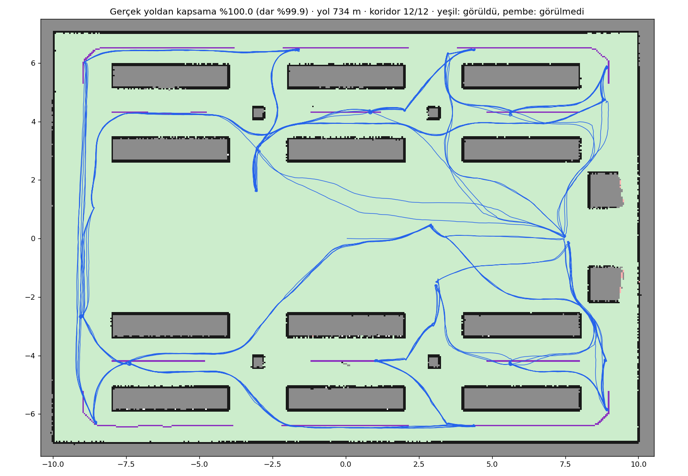
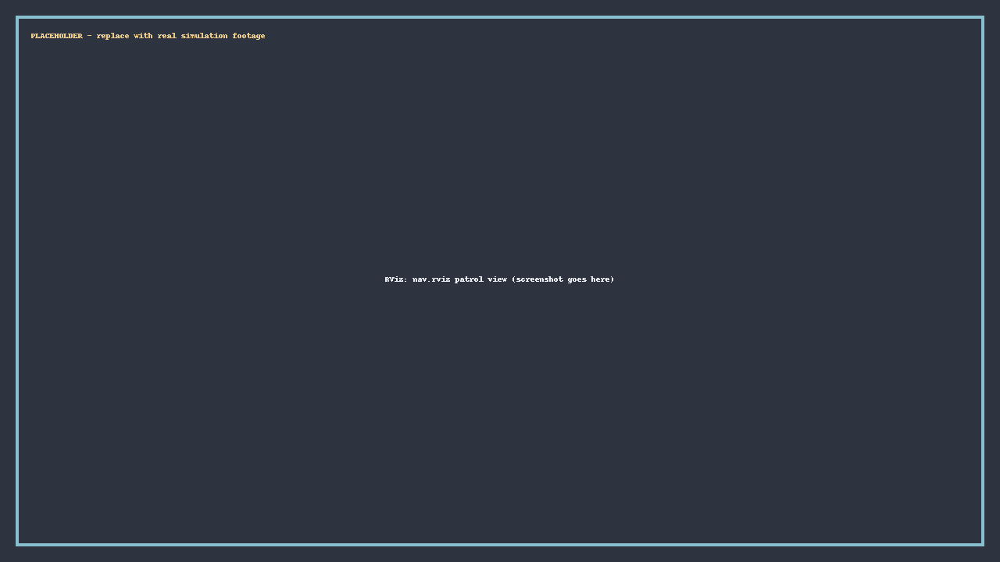

# Fabrika Güvenlik Robotu (`factory_security_bot_ws`)

[English](README.en.md) | **Türkçe**

[](https://github.com/KayraDev0/factory_security_bot_ws/actions/workflows/ci.yml)


[](LICENSE)

ROS 2 Jazzy ve Gazebo Harmonic üzerinde çalışan, **otonom fabrika güvenlik devriyesi** robotu
simülasyonu. Robot, kayıtlı bir doluluk haritasından kendi devriye rotasını üretir (medial eksen,
küme örtme, TSP), Nav2 ile bu rotayı sürer ve kamerasındaki görüntüde YOLOv8-pose ile **yerde yatan
insanı** tespit eder. Tespit edilen kişi olay listesine alınır, robot çevresinden kayıt toplar,
kişinin çevresine geçici bir yasak bölge koyar ve belirli aralıklarla durumu yeniden denetler.

<p align="center">
  
  <br><em>Haritadan otomatik üretilen devriye noktaları (29 waypoint, %95,02 planlı kapsama).</em>
</p>

<!-- DEMO: Gerçek bir simülasyon kaydıyla media/demo.gif dosyasını değiştirin. -->
<p align="center">
  
  <br><em>Demo GIF — <strong>yer tutucu</strong>, <code>media/demo.gif</code> dosyasını gerçek kayıtla değiştirin.</em>
</p>

> **Durum:** Tüm sonuçlar simülasyondan gelir. Gerçek robot henüz üretilmedi; donanım arayüzü
> (`fsb_hardware`) planlanmıştır, bu depoda yoktur. Ayrıntı: [docs/HARDWARE.md](docs/HARDWARE.md).

## İçindekiler
- [Mimari](#mimari) · [Gereksinimler](#gereksinimler) · [Kurulum](#kurulum) · [Kullanım](#kullanım)
- [Yapılandırma](#yapılandırma) · [Test](#test) · [Proje yapısı](#proje-yapısı) · [Belgeler](#belgeler)
- [Atıflar](#atıflar) · [Lisans](#lisans)

## Mimari

Simülasyon ve (planlanan) gerçek robot **aynı kontrol yığınını** kullanır; fark yalnızca
`use_sim` xacro argümanıyla seçilen ros2_control donanım eklentisidir. `use_sim_time`
`bringup.launch.py` içinde tek noktadan verilir.



Watchdog kapalıyken Nav2'nin `/cmd_vel` çıkışı doğrudan denetleyiciye gider.

| Bileşen | Görevi |
|---|---|
| **Gazebo + `ros_gz_bridge`** | Fabrika dünyası (20 × 14 m); LiDAR (`/scan`), kamera (`/camera/image_raw`, `/camera/camera_info`), IMU (`/imu`) ve `/clock` köprüsü |
| **ros2_control** | `joint_state_broadcaster` + `diff_drive_controller`; simülasyonda `gz_ros2_control` eklentisi |
| **robot_localization (EKF)** | Tekerlek odometrisi + IMU yaw hızı füzyonu; `odom→base_footprint` TF'inin tek sahibi |
| **SLAM Toolbox / AMCL** | `localization:=slam` ile haritalama, `localization:=amcl` ile lokalizasyon; `map→odom` TF'inin tek sahibi (ikisi asla birlikte açılmaz) |
| **Nav2** | Smac 2D global planlayıcı, Regulated Pure Pursuit yerel denetleyici, velocity smoother, collision monitor; engel kaynakları `/scan` ve `/security/keepout` |
| **`patrol_planner`** | Haritadan waypoint üretir (aşağıdaki akış); Nav2 olmadan da çalışır (`--cost grid`) |
| **`patrol_executor`** | Waypoint'leri sırayla (`idleness`, `sequential`, `random`) `NavigateToPose` ile gönderir; yatan insan olaylarını yönetir |
| **`coverage_monitor`** | Robotun gerçek kamera yolundan gerçekten görülen alan oranını ölçer |
| **`yolo_node`** | YOLOv8n-pose ile insan tespiti, kural tabanlı duruş sınıflandırma (`lying` / `upright` / `unknown`), zamansal doğrulamalı alarm |
| **`cmd_vel_watchdog`** | Komut akışı 0,5 s kesilirse sıfır hız yayınlar |

TF sahipliği ve odometri/sürüklenme önlemleri için [docs/ARCHITECTURE.md](docs/ARCHITECTURE.md).

### Devriye ve olay akışı



Olaylar `~/.ros/fsb_security` altında tutulur (`watchlist.yaml`, `events.jsonl`, kareler) ve yeniden
başlatmada geri yüklenir. Ayrıntı: [docs/PATROL_PLANNER.md](docs/PATROL_PLANNER.md),
[docs/PERCEPTION.md](docs/PERCEPTION.md).

<p align="center">
  
  <br><em>Gerçek devriye yolundan ölçülen kapsama (<code>coverage_monitor</code> çıktısı).</em>
</p>

## Gereksinimler

| Gereksinim | Sürüm / not |
|---|---|
| İşletim sistemi | Ubuntu 24.04 (Noble); WSL2 üzerinde de kullanılabilir |
| ROS 2 | Jazzy (`/opt/ros/jazzy`), [deb paketleriyle](https://docs.ros.org/en/jazzy/Installation/Ubuntu-Install-Debs.html) kurulu olmalı. Kurulum betiği ROS 2'nin kendisini kurmaz |
| Gazebo | Harmonic (gz-sim 8); `rosdep` ile `ros_gz_*` ve `gz_ros2_control` üzerinden gelir |
| Python | 3.12 (Ubuntu 24.04 sistem Python'u) |
| GPU (opsiyonel) | CUDA'lı NVIDIA GPU varsa YOLO `cuda:0` kullanır; yoksa CPU (`yolo_device:=cpu`). Çıkarım ~5 Hz'dir |
| Ağ | İlk Gazebo açılışında insan modelleri Fuel'dan indirilir (~29 MB) |

## Kurulum

```bash
# 1. Klonla
git clone https://github.com/KayraDev0/factory_security_bot_ws.git
cd factory_security_bot_ws

# 2. Sistem bağımlılıkları (apt araçları + rosdep ile tüm package.xml bağımlılıkları; sudo ister)
scripts/install_deps.sh             # yalnızca denetlemek için: scripts/install_deps.sh --check

# 3. Derle (--symlink-install kullanılmaz)
source /opt/ros/jazzy/setup.bash
colcon build
source install/setup.bash
```

`install_deps.sh` içinde `rosdep install --from-paths src --ignore-src --rosdistro jazzy -y`
çalışır; betiği kullanmadan doğrudan da verebilirsiniz.

### Algılama için Python ortamı (isteğe bağlı)
`ultralytics` ve `torch`, `cv_bridge`'i bozmamak için sistem OpenCV'sini gölgeleyen
`opencv-python` olmadan **ayrı bir venv**'e kurulur ve YOLOv8n-pose ağırlığı indirilir:

```bash
scripts/setup_perception_venv.sh                  # ~/fsb_venv ve ~/yolov8n-pose.pt
# yalnızca CPU:
TORCH_INDEX=https://download.pytorch.org/whl/cpu scripts/setup_perception_venv.sh
```

`VENV` ve `MODEL_DIR` ortam değişkenleriyle konumlar değiştirilebilir. Bu adım atlanırsa robot,
`perception:=false` (varsayılan) ile algılamasız çalışır.

## Kullanım

Her terminalde (hepsinde **aynı** `ROS_DOMAIN_ID`):

```bash
cd ~/factory_security_bot_ws
source /opt/ros/jazzy/setup.bash && source install/setup.bash
export ROS_DOMAIN_ID=85
```

Tek giriş noktası `fsb_bringup/launch/bringup.launch.py`'dir. Başlıca argümanlar:

| Argüman | Varsayılan | Açıklama |
|---|---|---|
| `use_sim` | `true` | `true`: Gazebo; `false`: gerçek robot (henüz yok) |
| `world` | `factory.sdf` | Gazebo dünyası (`factory_person.sdf`, `factory_lying.sdf`, `factory_negative.sdf`) |
| `headless` | `false` | `true`: yalnızca `gz sim -s`, GUI yok |
| `localization` | `none` | `none` \| `slam` (haritalama) \| `amcl` (AMCL + Nav2) |
| `map` | `fsb_navigation/maps/factory.yaml` | `amcl` için harita |
| `rviz` | `false` | RViz'i aç (`none` → `sim.rviz`, aksi halde `nav.rviz`) |
| `patrol` | `false` | Devriyeyi başlat (`localization:=amcl` gerekir) |
| `patrol_mode` | `idleness` | `idleness` \| `sequential` \| `random` \| `legacy` |
| `loops` | `0` | Tur sayısı, `0` = sonsuz |
| `coverage` | `false` | `coverage_monitor`'ı başlat |
| `perception` | `false` | YOLOv8 algısını başlat (`~/fsb_venv` gerekir) |
| `yolo_device` | otomatik | `cpu` \| `cuda:0` |
| `image_transport` | `raw` | `compressed`: JPEG akışı (YOLO başka makinede çalışacaksa) |
| `cmd_vel_watchdog` | `false` | Komut bekçisini araya koy |
| `revisit_interval` | `300.0` | Yatan insanı yeniden denetleme süresi (sim-s) |
| `security_log_dir` | `~/.ros/fsb_security` | Olay listesi, `events.jsonl`, kareler |

### 1. Simülasyonu başlat
```bash
ros2 launch fsb_bringup bringup.launch.py                   # Gazebo GUI ile
ros2 launch fsb_bringup bringup.launch.py headless:=true    # yalnızca sunucu
```
Sıra: `robot_state_publisher` → Gazebo + köprü + spawn → `joint_state_broadcaster` →
`diff_drive_controller` → EKF.

<p align="center">
  
  <br><em>Gazebo fabrika dünyası — <strong>yer tutucu</strong>, <code>media/screenshot_gazebo.png</code> dosyasını değiştirin.</em>
</p>

### 2. SLAM ile harita çıkar ve kaydet
```bash
# Terminal 1: haritalama (map→odom: SLAM Toolbox)
ros2 launch fsb_bringup bringup.launch.py headless:=true localization:=slam rviz:=true

# Terminal 2: betikli tur (veya teleop ile elle sür)
ros2 run fsb_gazebo mapping_tour.py

# Terminal 3: haritayı kaydet
mkdir -p ~/maps
ros2 run nav2_map_server map_saver_cli -f ~/maps/factory_new \
    --ros-args -p use_sim_time:=true

# Harita kalitesini ölç (isteğe bağlı)
ros2 run fsb_gazebo map_quality_check.py --map ~/maps/factory_new.yaml
```
Haritalamada açısal hız sınırlı tutulur (betikli tur: 0,15 m/s, ≤ 0,4 rad/s); bu, SLAM
sürüklenmesini önler.

### 3. Kayıtlı haritayla navigasyon
```bash
ros2 launch fsb_bringup bringup.launch.py localization:=amcl rviz:=true \
    map:=$HOME/maps/factory_new.yaml
```
Depodaki hazır harita (`fsb_navigation/maps/factory.yaml`) `map` verilmezse kullanılır. RViz'de
*2D Pose Estimate* ve *Nav2 Goal* araçlarıyla hedef verebilirsiniz.

<p align="center">
  
  <br><em>RViz <code>nav.rviz</code> görünümü — <strong>yer tutucu</strong>, <code>media/screenshot_rviz.png</code> dosyasını değiştirin.</em>
</p>

### 4. Devriye planla ve başlat
Waypoint'ler haritadan üretilir; dünya koordinatı koda gömülü değildir:
```bash
ros2 run fsb_patrol patrol_planner --cost grid \
    --map src/fsb_navigation/maps/factory.yaml \
    --robot-params src/fsb_patrol/config/robot_params.yaml \
    --out /tmp/wp.yaml --png /tmp/wp.png
# hedef kapsama sağlanamazsa çıkış kodu 2
```
`--cost nav2` için Nav2 maliyetlerini kullanan arka uç `ros2 launch fsb_patrol planner_backend.launch.py map:=<yaml>`
ile açılır. Depodaki `config/waypoints_factory.yaml` hazır fabrika haritası içindir; yeni harita için
yeniden üretin.

Devriyeyi tek komutla başlatmak (Gazebo + RViz + AMCL/Nav2 + `patrol_executor`):
```bash
ros2 launch fsb_bringup bringup.launch.py localization:=amcl rviz:=true patrol:=true loops:=5
# patrol_mode:=sequential | random | legacy, coverage:=true
```
Veya Nav2 hazır olduktan sonra ayrı bir terminalde, kendi waypoint dosyanızla:
```bash
ros2 launch fsb_patrol patrol_executor.launch.py use_sim_time:=true mode:=idleness loops:=5 \
    waypoints_file:=/tmp/wp.yaml
```

### 5. Algılama ve alarmları izle
Yatan insanlı dünyada algılamayla birlikte:
```bash
ros2 launch fsb_bringup bringup.launch.py localization:=amcl rviz:=true patrol:=true \
    perception:=true \
    world:=$(ros2 pkg prefix fsb_gazebo)/share/fsb_gazebo/worlds/factory_lying.sdf
# YOLO başka makinede / dar bant: image_transport:=compressed cmd_vel_watchdog:=true
```
Başka bir terminalde:
```bash
ros2 topic hz   /perception/detections      # ~5 Hz
ros2 topic echo /perception/posture --once  # lying | upright | unknown
ros2 topic echo /security/alerts            # yatan insan alarmı (vision_msgs/Detection2D)
ros2 run rqt_image_view rqt_image_view      # /perception/image_annotated
ros2 run fsb_gazebo posture_monitor.py      # duruş sayıları + alarm özeti (Ctrl+C)
```
| Topic | Tür | İçerik |
|---|---|---|
| `/perception/detections` | `vision_msgs/Detection2DArray` | İnsan tespitleri |
| `/perception/posture` | `std_msgs/String` | Duruş sınıfı |
| `/perception/image_annotated` | `sensor_msgs/Image` | Çizimli kare (`/compressed` varyantı da var) |
| `/security/alerts` | `vision_msgs/Detection2D` | Zamansal doğrulamalı yatan-insan alarmı |
| `/security/keepout` | `sensor_msgs/PointCloud2` | Nav2 engel katmanına verilen yasak bölge |
| `/patrol/waypoints` | `visualization_msgs/MarkerArray` | Durum renkli waypoint'ler ve olay işaretleri |

RViz'de (`nav.rviz`): turuncu = mevcut hedef, yeşil = ziyaret edildi, kırmızı = atlandı, mavi =
bekliyor, mor = öncelikli nokta; kırmızı küre = olay listesindeki yatan insan.

### 6. RViz
`rviz:=true` ile açılır; `localization:=none` iken `sim.rviz` (sabit çerçeve `odom`; tarama, kamera,
EKF), `slam`/`amcl` iken `nav.rviz` (sabit çerçeve `map`; harita, AMCL parçacıkları, planlar,
costmap'ler, waypoint'ler, YOLO görüntüsü). Yalnızca robot modeli için:
`ros2 launch fsb_description display.launch.py`.

## Yapılandırma

| Dosya | Ne işe yarar |
|---|---|
| `fsb_description/urdf/fsb_properties.xacro` | **Fiziksel parametrelerin tek kaynağı** (tekerlek, gövde, sensör konumları, kütleler) |
| `fsb_control/config/controllers.yaml` | `joint_state_broadcaster`, `diff_drive_controller` (hız/ivme sınırları, `enable_odom_tf: false`) |
| `fsb_control/config/ekf.yaml` | `robot_localization` EKF füzyonu (tekerlek odometrisi + IMU yaw hızı) |
| `fsb_gazebo/config/gz_bridge.yaml` | Gazebo → ROS köprü topic'leri (`/clock`, `/scan`, `/camera/*`, `/imu`) |
| `fsb_navigation/config/nav2_params.yaml` | AMCL, map_server, bt_navigator, RPP, Smac 2D, costmap'ler, velocity smoother, collision monitor |
| `fsb_navigation/config/slam_toolbox_mapping.yaml` | Online async haritalama parametreleri |
| `fsb_patrol/config/robot_params.yaml` | Planlayıcı girdisi: robot yarıçapı, güvenlik payı, kamera FoV/menzil, costmap şişirme |
| `fsb_patrol/config/waypoints_factory.yaml` | Fabrika haritası için üretilmiş waypoint'ler ve yol uzunluğu matrisi |
| `fsb_patrol/config/priority_points_factory.yaml` | Elle belirlenen, daha sık ziyaret edilecek öncelikli noktalar (`weight`) |
| `fsb_patrol/config/patrol.yaml` | Eski 4 noktalı `patrol_node` waypoint'leri |
| `fsb_perception/config/yolo.yaml` | Model yolu, güven eşiği, çıkarım hızı, duruş ve alarm eşikleri |

Hız sınırları (RPP, smoother, denetleyici) birbiriyle tutarlı olmak zorundadır; bu bir testle
korunur. `use_sim_time` yalnızca launch argümanıyla verilir, yaml içinde tutulmaz.

## Test

```bash
colcon test
colcon test-result --all --verbose
# veya CI ile aynı adımlar:
scripts/ci.sh
```
Seviye 1 (lint + birim testleri) ve Seviye 2 (planlayıcı, 7 harita varyantı) simülatör ya da GPU
gerektirmez ve CI'da çalışır. Seviye 3 (algılama) ve 4 (simülasyon entegrasyonu) elle çalıştırılır;
komutlar ve ölçülen sonuçlar için [docs/TESTING.md](docs/TESTING.md).

## Proje yapısı

```
factory_security_bot_ws/
├── src/
│   ├── fsb_bringup/       # Tek giriş noktası (bringup.launch.py), RViz yapılandırmaları
│   ├── fsb_control/       # ros2_control, EKF yapılandırması, cmd_vel_watchdog
│   ├── fsb_description/   # URDF/xacro robot modeli, fiziksel parametreler, tutarlılık testi
│   ├── fsb_gazebo/        # Fabrika dünyaları, gz köprüsü, sim launch, ölçüm betikleri
│   ├── fsb_navigation/    # SLAM Toolbox, AMCL, Nav2 yapılandırması, kayıtlı harita
│   ├── fsb_patrol/        # patrol_planner, patrol_executor, olay yönetimi, coverage_monitor
│   └── fsb_perception/    # yolo_node (YOLOv8-pose), duruş kuralları, görüntü sıkıştırma
├── docs/                  # Mimari, donanım, algılama, devriye, test belgeleri ve görseller
├── media/                 # README görselleri, demo GIF ve ekran görüntüleri
├── scripts/               # install_deps.sh, setup_perception_venv.sh, ci.sh
└── .github/workflows/     # CI (ros:jazzy container'ında build + test)
```

## Belgeler

| Belge | İçerik |
|---|---|
| [docs/ARCHITECTURE.md](docs/ARCHITECTURE.md) | Tasarım hedefi, paketler, TF sahipliği, odometri, komut yolu |
| [docs/PATROL_PLANNER.md](docs/PATROL_PLANNER.md) | Waypoint planlama, devriye modları, olay yönetimi, sonuçlar |
| [docs/PERCEPTION.md](docs/PERCEPTION.md) | YOLOv8-pose düğümü, duruş kuralları, ölçümler, sınırlamalar |
| [docs/HARDWARE.md](docs/HARDWARE.md) | Planlanan donanım, motor seçimi hesapları, doğrulanmamış maddeler |
| [docs/firmware.md](docs/firmware.md) | Arduino Nano firmware derleme/yükleme notları |
| [docs/TESTING.md](docs/TESTING.md) | Dört seviyeli test planı ve simülasyon ölçümleri |

## Atıflar

Aşağıdaki bileşenler bu depoya **kopyalanmamıştır**; apt, pip veya Gazebo Fuel ile kurulur ya da
ayrı bir depodan kullanılır. Lisanslar, bileşenlerin kendi kaynaklarından (paket `package.xml`
dosyaları, GitHub depoları, PyPI, Fuel API) 2026-11-20 tarihinde okunmuştur.

| Bileşen | Kullanım | Lisans |
|---|---|---|
| [Andino](https://github.com/Ekumen-OS/andino) (Ekumen) | Referans donanım platformu: ölçüler ve firmware dış bağımlılık olarak | BSD-3-Clause, Copyright (c) 2023 Ekumen Inc. |
| [Ultralytics YOLOv8](https://github.com/ultralytics/ultralytics) | `fsb_perception` çalışma zamanı bağımlılığı, **ayrı venv**'de; `yolov8n-pose.pt` ağırlığı kurulum betiğiyle indirilir | AGPL-3.0 (alternatif: Ultralytics Enterprise lisansı) |
| [ROS 2 Jazzy](https://docs.ros.org/en/jazzy/) (rclpy, tf2, launch…) | Çatı | Çoğunlukla Apache-2.0 |
| [Nav2](https://github.com/ros-navigation/navigation2) | Navigasyon yığını | Apache-2.0; `nav2_amcl` LGPL-2.1-or-later |
| [SLAM Toolbox](https://github.com/SteveMacenski/slam_toolbox) | Haritalama | LGPL |
| [ros2_control](https://github.com/ros-controls/ros2_control) / [ros2_controllers](https://github.com/ros-controls/ros2_controllers) | Denetleyici yönetimi, `diff_drive_controller` | Apache-2.0 |
| [robot_localization](https://github.com/cra-ros-pkg/robot_localization) | EKF | Apache-2.0 |
| [Gazebo Sim (Harmonic)](https://github.com/gazebosim/gz-sim), [ros_gz](https://github.com/gazebosim/ros_gz), [gz_ros2_control](https://github.com/ros-controls/gz_ros2_control) | Simülasyon ve ROS entegrasyonu | Apache-2.0 |

**Gazebo Fuel insan modelleri** (OpenRobotics; depoda tutulmaz, ilk açılışta `~/.gz/fuel` altına
indirilir):

| Model | Kullanıldığı yer | Lisans |
|---|---|---|
| Walking person | `factory_person.sdf`, `factory_negative.sdf` | CC0 1.0 |
| Casual female | `factory_lying.sdf` | CC0 1.0 |
| Standing person | `generate_factory_world.py` ile üretilen dünyalar | CC0 1.0 |
| Rescue Randy | `generate_factory_world.py` ile üretilen dünyalar | CC BY 4.0 (atıf: OpenRobotics) |

**Ultralytics notu:** `fsb_perception` Ultralytics kodu içermez, yalnızca çalışma zamanında
`import` eder; Ultralytics bu depoda dağıtılmaz. Bu düğümü içeren bir sistemi dağıtacak ya da ağ
hizmeti olarak sunacaksanız güncel lisans koşullarını (AGPL-3.0 veya ticari lisans) kendiniz
inceleyin. Bu not hukuki tavsiye değildir.

**Andino notu:** Robotun ölçüleri Andino'dan elle yeniden girilmiştir; Andino dosyası
kopyalanmamıştır. Firmware ve 3B baskı (STL) dosyaları depoda yoktur; Andino deposundan indirilir.
Firmware ikili olarak dağıtılırsa Andino'nun lisans bildirimi eşlik etmelidir.

## Lisans

Bu depodaki kaynak kod [Apache License 2.0](LICENSE) ile lisanslanmıştır —
Copyright 2026 KayraDev0. Yukarıda listelenen üçüncü taraf bileşenler kendi lisanslarına tabidir.
